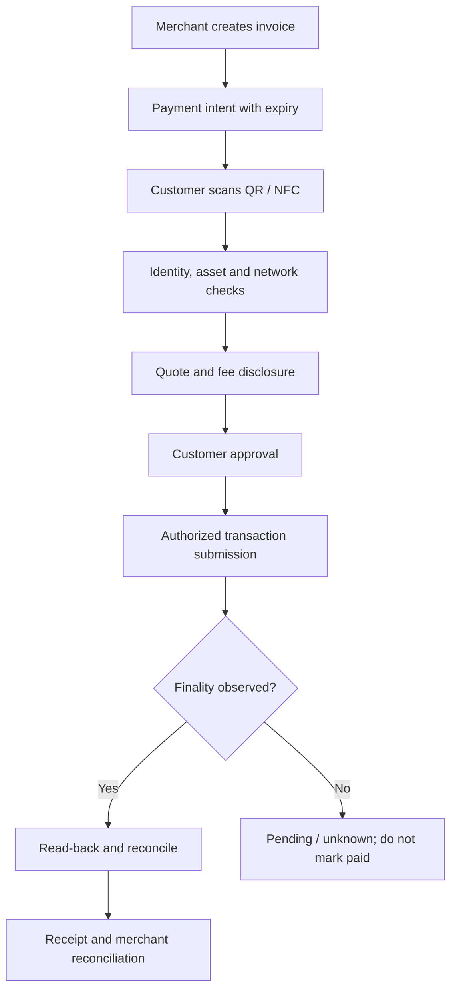
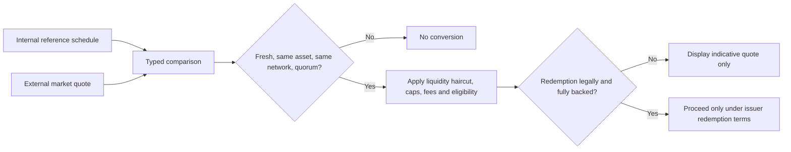
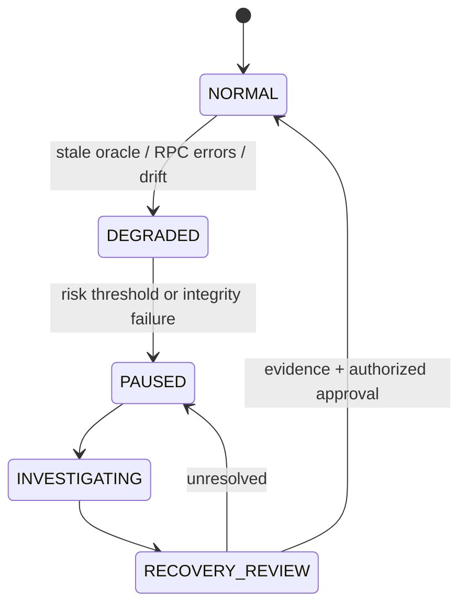
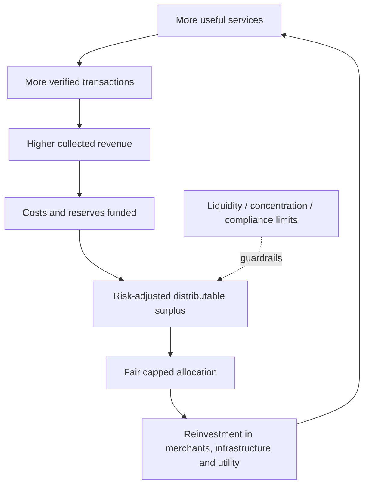

# Economic User and Operations Flows

## A. Merchant payment

## B. Internal reference to external quote

A displayed internal reference is not a user cash balance. A displayed external quote is venue-specific. A ratio between them must never silently create a 1:many conversion.

## C. Incident / pause path

## D. Scale without monetary dilution

## Operational invariants

- Do not show success before network finality and read-back.
- Do not convert a simulation to a live quote by changing a label.
- Do not claim a token burn when only an internal ledger entry is retired.
- Do not allow treasury write actions from a public UI without privileged authorization.
- Preserve a trace from UI request to API request ID, policy version, contract event and ledger transaction.
