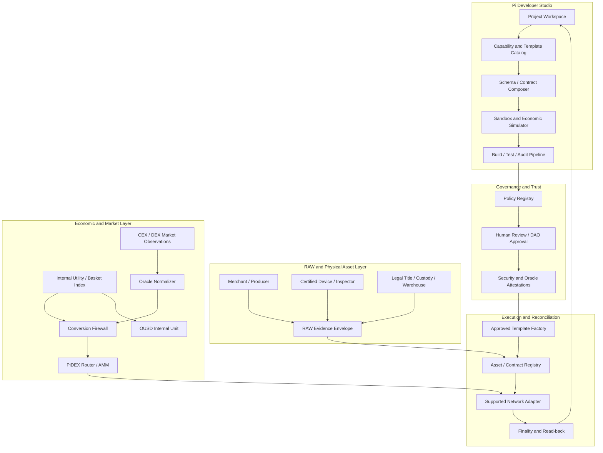
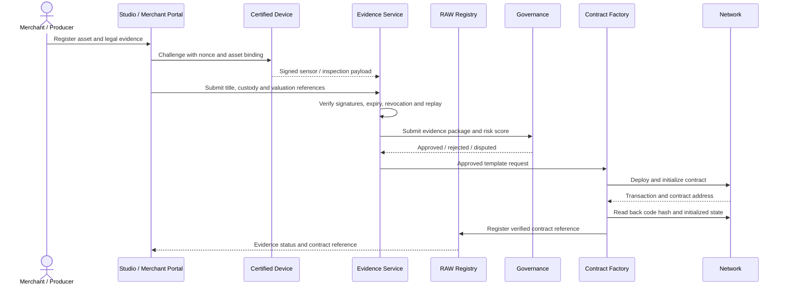

# Omni Developer Studio, PiDEX and Physical Economy Architecture

**Status:** Application reference architecture. Components are proposed or scaffolded unless deployment evidence is explicitly linked.

## 1. Application map

## 2. Pi Developer Studio workflow

The Studio is a controlled developer tool, not an unrestricted contract generator.

1. Select a capability from a versioned catalog (RWA, merchant invoice, escrow, registry, oracle adapter, AMM pool, governance proposal).
2. Declare network, asset, issuer, decimals, permissions, data schema and intended legal/economic rights.
3. Generate code only from approved templates and pinned dependencies.
4. Run schema validation, lint, unit/property/fuzz tests, static analysis, dependency/SBOM and resource-budget checks.
5. Run local simulation and testnet deployment in a sandbox.
6. Submit evidence bundle to human review and governance.
7. Deploy only an approved immutable template; verify transaction, code hash, contract ID and initialized state by read-back.
8. Monitor, pause, upgrade or revoke only under a preapproved lifecycle policy.

AI agents may suggest features, generate draft code, explain failures and prepare PRs. They cannot self-approve, merge protected branches, access production secrets, sign arbitrary transactions, or alter monetary policy without an authorized human/governance action.

## 3. RAW record and physical asset lifecycle

A digital record is not physical truth. The evidence layer must identify the trusted inspector, device, custody provider, legal issuer and jurisdiction. NFC/QR/image hashes are not a substitute for signatures, title checks or inspection.

## 4. Internal utility valuation and price stability

USD is a reporting numeraire. Internal price formation should reference goods/services and a disclosed basket, not CEX token prices alone.

For item i:
`p_i,t = verified local offer adjusted for condition, quantity, delivery, warranty and availability`

Basket index:
`I_t = sum_i(w_i × p_i,t / p_i,0) / sum_i(w_i)`

Internal unit value:
`U_internal_t = U_0 × I_t`

Weights are versioned, bounded and governed; missing data reduces coverage and must not be silently imputed as zero. The index should use robust aggregation, geographic segmentation, substitution rules, freshness and confidence bands. This supports a stable internal unit of account only if the issuer commits to the basket and has capacity to fulfil or redeem it. It does not create a USD peg.

Internal utility growth should be earned through product quality, service delivery, merchant availability, inventory, productivity, reduced fulfillment costs and verified demand. More decimals or token supply do not increase purchasing power.

## 5. External market pricing: CEX and DEX

CEX:
- capture bid/ask depth and trades with venue, pair, timestamp, status and withdrawal/deposit capability;
- calculate executable VWAP for notional sizes;
- exclude stale, suspended, wash-traded or non-withdrawable observations;
- disclose custody and counterparty risk.

DEX:
- read pool reserves and fees from a verified contract;
- compute quote and slippage for the exact route and amount;
- account for price impact, MEV, liquidity concentration and finality;
- do not equate a pool mid-price with executable depth.

A market composite must include source independence, liquidity quality, coverage, freshness, outlier policy and confidence. Never use reported volume as the sole weight.

## 6. PiDEX formulas

For a constant-product pool with reserves x and y, input Δx, fee F and denominator D:

`dx_net = floor(Δx × (D-F) / D)`
`dy = floor(dx_net × y / (x + dx_net))`
`k = x × y` (subject to fees, rounding and the exact contract implementation)

Spot price before trade is `y/x`; execution price is `dy/Δx`; price impact is the difference between spot and execution price. Include protocol fee, LP fee, rounding dust and minimum output in the quote.

The legacy `contracts/pi_dex_engine.rs` is a floating-point simulation and must not be used for production accounting. Use integer atomic units and checked arithmetic in contracts. The `contracts/pidex_amm` Soroban crate is a separate reference implementation requiring complete review and named-network tests.

## 7. OUSD role and stability controls

The current OUSD contract in SmartContracts is a test-only token. The application must label it `TEST_ONLY / NOT USD-PEGGED / NOT REDEEMABLE` until a different issuer-backed product is legally and technically implemented.

Preferred internal stability path:
- use a basket unit-of-account to price platform goods/services;
- let merchants quote in local goods/services and show USD only as a comparison;
- keep CEX PI/USD price as external market information;
- do not auto-reprice internal goods based on short-term token volatility;
- if an OUSD claim is redeemable, maintain segregated reserves and matching liabilities with independent attestations and disclosed redemption terms.

## 8. Oracle and data-source design

Normalize Chainlink, independent oracle reporters, CEX, DEX, merchant offers, inventory, commodity indexes and inspection evidence into typed source records. A Chainlink EVM AggregatorV3 feed is network-specific; it is not automatically available on Soroban. Each source adapter must publish network, asset, pair, unit, decimals, timestamp, sequence, confidence, signature/proof and source policy.

Use:
- quorum and source independence;
- heartbeat and stale-data rejection;
- deviation and outlier controls;
- coverage score and source-quality weight;
- circuit breaker and human incident review;
- audit logs and replay protection.

An AI model may flag anomalies or estimate demand. It must not be the sole authority for price, title, reserve or redemption.

## 9. Seven-layer injection and extension model

The seven colors are a UI/governance taxonomy, not seven native Pi currencies. A contract template may declare one or more layer tags, but deployment is gated by the capability registry and governance policy. No automatic "inject into seven currencies" behavior is permitted. Asset mapping must be explicit and typed: asset ID, issuer, network, decimals, rights, layer tag, backing and transfer restrictions.

## 10. Differential geometry and quantitative engine

Use differential geometry as an optional analytical layer for liquidity/risk state surfaces:
- state vector: reserves, depth, inventory, demand, volatility, concentration and delivery risk;
- objective: minimize expected slippage, insolvency risk or fulfilment cost;
- metric tensor: calibrated local cost/risk sensitivity;
- gradient/Hessian: marginal and second-order sensitivity;
- stress tests: shocks, sparse data, discontinuities and regime changes.

These outputs are risk signals, not minting multipliers or token-price guarantees. Document calibration, units, boundary conditions and model risk.

## 11. Post-quantum readiness

Adopt crypto agility, not a premature "quantum-secured" label. Maintain algorithm IDs, key versions, revocation and rotation. Evaluate ML-KEM (FIPS 203), ML-DSA (FIPS 204) and SLH-DSA (FIPS 205) for off-chain identity and evidence signing. Hybrid migration requires downgrade resistance and dual validation. On-chain use depends on actual Soroban/network support, payload size and resource budgets. A hash anchor does not prove PQ signatures were verified on-chain.

## 12. Required UI states

Every economic UI element must disclose:
- observed / derived / simulated / proposed / verified;
- internal index or external market quote;
- asset, network, unit, venue, timestamp and confidence;
- reserve / redemption status;
- data coverage and stale warning;
- pending / final / failed / unknown transaction status.

Never show "paid", "deployed", "verified" or "redeemable" before independent evidence and read-back.
