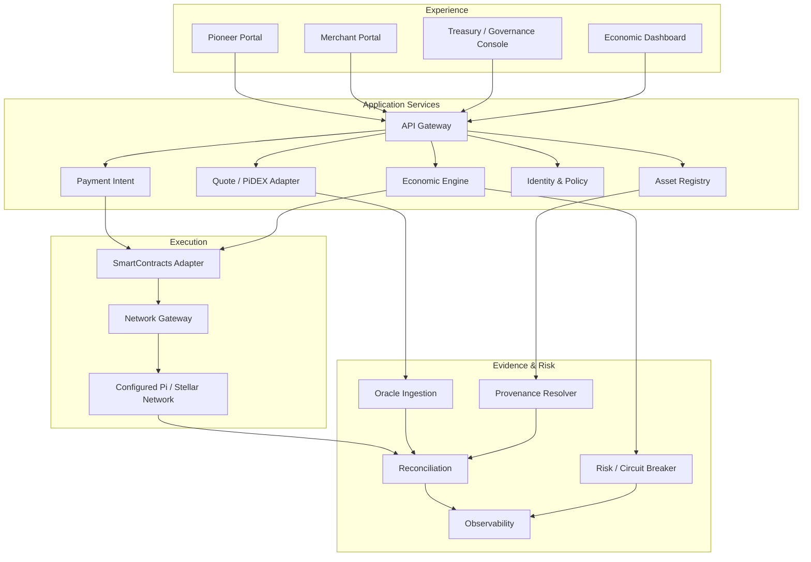
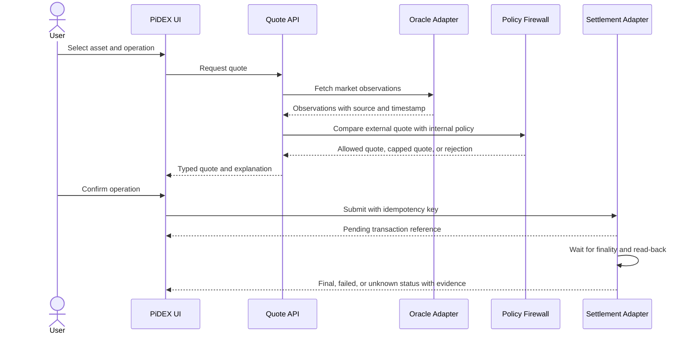

# Sovereign Economic Application Map

**Status:** Application reference architecture. Proposed modules are not evidence of live financial services.

## Service map

## Data and trust rules

- Every API response carries request ID, environment, network domain, data source, freshness and verification state.
- Market quote, internal reference, simulated price, collateral estimate, reserve and redeemable liability are distinct typed fields.
- A contract ID is not proof of issuer identity, code hash, audit, reserves or redemption.
- A market chart is not proof of an order book, pool, liquidity or completed trade.
- A successful transaction submission is not finality; read back ledger state and reconcile.
- Unsupported capability returns a stable typed error (for example `UNSUPPORTED_CAPABILITY`), never a fabricated success.
- Secrets and signing authority remain server-side in a separately controlled signer/relayer; no private key or seed phrase reaches the browser.

## Dual-value user journey

## Economic dashboard semantics

| Display | Required label |
|---|---|
| Exchange quote | Venue, pair, timestamp, depth and source |
| Internal reference | Policy version and effective period |
| Sovereign ratio | Scenario/index only; not a redemption rate |
| Simulated supply / emissions | SIMULATED |
| Reserve estimate | ESTIMATE until independently attested |
| Verified reserve | Custodian, liability scope, timestamp and attestation |
| Payment state | Pending / final / failed / unknown |
| Contract state | Network, contract ID, code hash and read-back status |

## Operational gates

1. Read-only mode by default for new adapters.
2. Explicit environment allowlist and network passphrase check.
3. Dry-run and transaction simulation before write operations.
4. Human approval and multisig for treasury or supply-critical actions.
5. Idempotency, rate limits, circuit breakers and bounded retries.
6. Reconciliation job with alerting on state drift.
7. Separate preview, staging, Testnet and production configuration.
8. No automatic harvesting of branches, deployment of every WASM, or unrestricted signer workflow.
