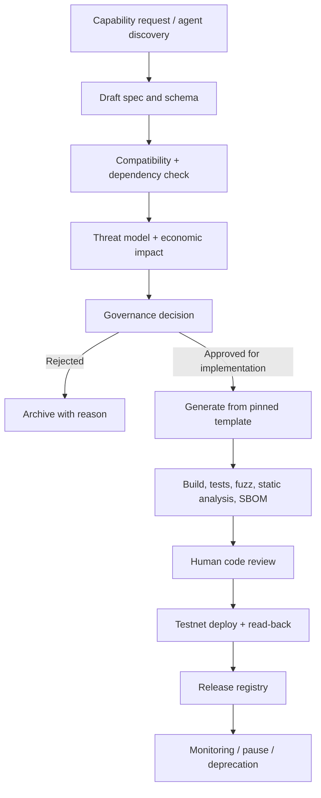

# Omni Capability Registry and Branch Intake

## 1. Capability registry

Each feature/template must declare:

| Field | Requirement |
|---|---|
| capability_id | Stable, namespaced identifier |
| version | Semantic version and immutable schema version |
| owner_repo | PiRC, SmartContracts or Unity Sphere |
| layer_tags | Explicit community taxonomy tags; never imply native token class |
| network_support | Exact network ID/passphrase and supported operations |
| asset_scope | Native asset, contract-issued asset, internal credit or RWA right |
| permissions | Roles, thresholds, multisig and signer boundary |
| evidence | Oracle, legal, physical, reserve and audit requirements |
| lifecycle | Draft, proposed, approved, tested, testnet-verified, audited, production-verified, deprecated |
| dependencies | Pinned code hashes, SDK and interface versions |
| risk_class | Financial, custody, identity, oracle, physical, cryptographic and operational |
| conformance | Required schema, unit, property, fuzz, integration and adversarial tests |
| rollback | Pause, migration, key rotation and recovery plan |

## 2. Feature generation lifecycle

AI agents may discover missing features, draft specifications, generate code and open PRs. They cannot independently approve their own work, merge protected branches, operate production signers, modify reserve policy or deploy arbitrary code.

## 3. Branch intake findings

The point-in-time GitHub discovery on 2026-11-03 found 164 branches in PiRC, 281 in SmartContracts and 149 in Unity Sphere. The three repositories also contain copied/nested repository snapshots and generated/vendor material. A branch name is not a capability status; same-name branches across repositories are not assumed synchronized.

Priority isolated work areas include:
- PiRC and Unity Sphere `Raw` snapshots;
- `omni-factory-release` factory and physical-RWA package;
- `feature/v3-auto-pr-factory` and related automation workflows;
- `feature/quantum-legacy-core` and `feature/quantum-legacy-optimized`;
- `feat/pirc-06-ai-oracles`, `feat/pirc-07-governance-execution`, `feat/pirc-08-rwa-tokenization`, `feat/pirc-09-liquidity-amm`, `feat/pirc-212-autonomous-agent` and `feat/pirc-213-224-rwa`;
- RWA examples/specification and threat-model branches.

## 4. High-priority code findings

- RAW factory scaffold returns a product ID and emits an event; it does not deploy a contract.
- RAW factory SDK returns a placeholder transaction hash.
- Physical possession scaffold returns `true` without verifying its signature input.
- Mock scanner hashes user/product/time; it does not sign with a certified hardware key.
- Legacy PiDEX simulation uses floating point; it is not suitable for contract settlement.
- Soroban oracle V2 stores a latest authorized reporter record; it is not by itself a multi-source median/quorum oracle.
- AI Oracle proof hash is a commitment; no proof verification is performed by that contract.
- OUSD test token is not backed, pegged or redeemable.
- Chainlink EVM adapter requires exact feed/network configuration and is not automatically callable from Soroban.
- Quantum legacy paths do not establish production post-quantum support.

## 5. Intake and safety protocol

1. Record branch SHA and compare against current main.
2. Identify unique source files vs copied nested snapshots, vendored dependencies and generated assets.
3. Map code to capability ID and normative PiRC spec.
4. Review workflow permissions, deploy scripts, secret access and branch protections.
5. Run tests and security checks in an isolated environment.
6. Create narrow PRs per capability, not one bulk branch merge.
7. Require a human reviewer, governance approval where relevant, and explicit release evidence.
8. Preserve source branches; no force-push or automatic branch deletion.
9. Do not execute scripts that push to main, deploy WASM, mint, transfer or sign without explicit approval.

## 6. Source-of-truth rule

- PiRC: normative economic, identity, oracle, governance and RWA requirements.
- SmartContracts: Soroban implementation, state, authorization, events and contract tests.
- Unity Sphere: Studio, APIs, user experience, adapters, orchestration, observability and deployment.
- RAW evidence: off-chain/physical attestations with hashes and signed claims; not a substitute for legal title or chain finality.

The capability registry is the cross-repository index; duplicated snapshots must link back to canonical files rather than silently becoming alternative sources.
